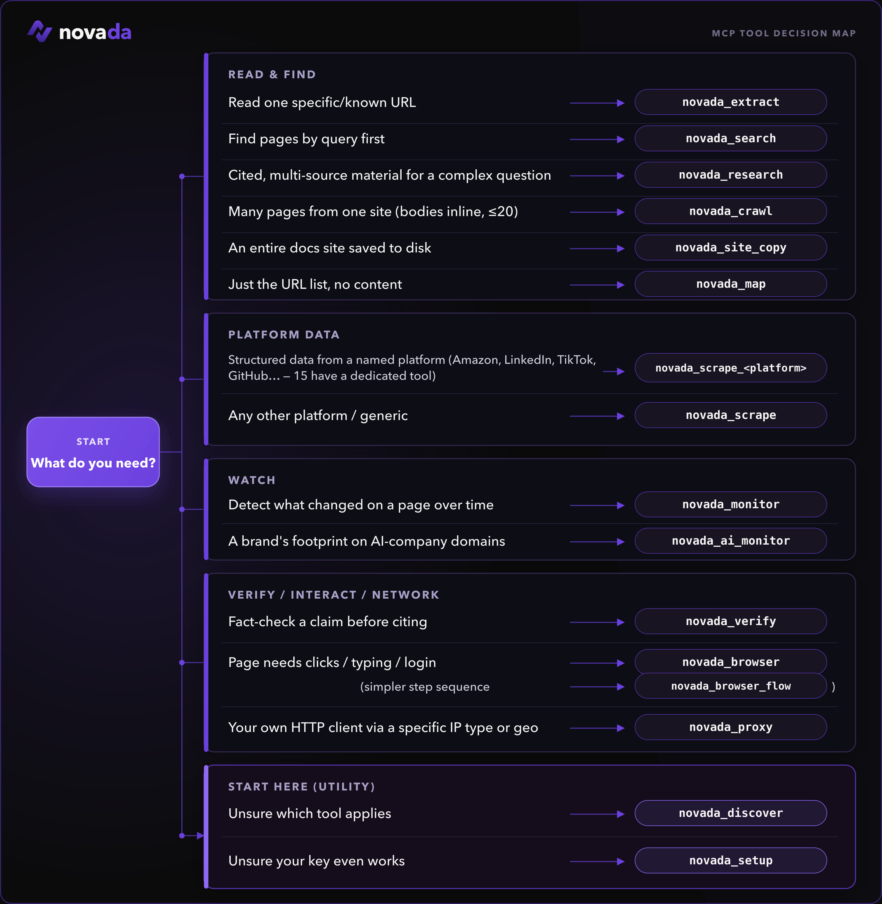

# Novada MCP

Web search, page extraction and structured platform data for AI agents, backed by Novada's own proxy network.

[](https://www.npmjs.com/package/novada-mcp)
[](https://www.npmjs.com/package/novada-mcp)
[](https://github.com/NovadaLabs/novada-mcp/actions/workflows/ci.yml)
[](LICENSE)

[](https://www.novada.com)

**Free to start:** $10 in credits, up to 1,000 calls a month, no credit card.

## What it is good at

- **Structured data from 14 sources, no HTML parsing.** One typed tool per platform (Amazon, Google, LinkedIn, TikTok, YouTube, Instagram, Facebook, X, Walmart, GitHub and more). The `operation` is a closed list, so a wrong value is rejected before any call and the error lists the valid ones.
- **Pages that block bots.** `novada_extract` escalates from a plain fetch to JS render to a real browser on its own, takes up to 10 URLs per call, and names the blocker when it cannot get through (for example `anti_bot:kasada`).
- **Cited research in one call.** `novada_research` runs several searches, de-duplicates, and returns numbered source passages for your agent to write the answer from. It returns source material, not a generated summary.

## Try these prompts

| Use case | Ask your agent |
|---|---|
| Price research | "Compare the top 5 Amazon results for 'standing desk' by price and rating, then check the cheapest one on Walmart." |
| Lead research | "List open Data Analyst jobs at LinkedIn for Germany posted this week, with company and link." |
| Cited answer | "What changed in the EU battery regulation this year? Give me sources I can quote." |

## Quickstart

Hosted, nothing to install. Sign up at [novada.com](https://www.novada.com) for a key; check your balance any time with `novada_setup`.

**claude.ai:** Settings → Connectors → Add custom connector, paste `https://mcp.novada.com/mcp`, sign in with your Novada account (OAuth).

**Claude Code:**

```bash
claude mcp add --transport http novada https://mcp.novada.com/mcp --header "Authorization: Bearer YOUR_KEY"
```

Cursor, Windsurf, VS Code and self-host (`npx -y novada-mcp`): see the [install guide](./npm-package/README.md). The hosted endpoint accepts the key only in an `Authorization: Bearer` header or via OAuth, never in a URL.

## How to choose a tool

[](https://www.novada.com)

| Tool | Use it when |
|------|-------------|
| `novada_search` | Find pages by query (google / duckduckgo / yandex; time, domain, geo filters). |
| `novada_extract` | Read one known URL, or up to 10 in parallel, through anti-bot pages. |
| `novada_research` | Answer a complex question with passages from several sources in one call. |
| `novada_scrape` | Structured records from 14 platforms, plus 14 typed tools such as `novada_scrape_amazon` and `novada_scrape_linkedin`. |
| `novada_crawl` | Pull content from a bounded set of related pages (up to 20) on one site. |
| `novada_map` | Discover what URLs exist on a site before fetching. |
| `novada_proxy` | Route your own HTTP client through a specific IP type, country or session. |

Not sure? Call `novada_discover`. 37 tools self-hosted; the hosted endpoint exposes 28 of them (self-host adds browser automation and site copy). Full list and per-surface availability: [docs/TOOLS.md](docs/TOOLS.md).

## How it compares

| | Typed platform scrapers | Search / extract / crawl / map | Own proxy network | Notes |
|---|:--:|:--:|:--:|---|
| **Novada** | Yes (14) | Yes, plus research | Yes | Proxy config from Novada's own network via `novada_proxy` |
| Tavily | No | Yes | No | Search, extract, map, crawl |
| Firecrawl | No | Yes | No | Scrape, crawl, search, extract and an agent tool |
| Bright Data | Yes | Yes | Yes | Closest in scope |

Pick Tavily or Firecrawl if you only need search and page-to-markdown. Pick Novada or Bright Data if you also need records from specific platforms or control over proxy routing. Comparison reflects each project's public MCP README as of 2026-10-26; check theirs for current details.

Built for agents: write operations (proxy sub-accounts, IP whitelist, static IPs, key capture) use a two-step approval token, and `novada_discover` and `novada_setup` let an agent find the right tool or check its key without reading this page. Basic `novada_extract` also works without a key (no render escalation).

## Repository layout

`npm-package/` is the `novada-mcp` package and holds all tool logic. `hosted-server/` is the HTTP wrapper behind `mcp.novada.com`. `distribution/` holds plugin and registry packaging plus the release consistency check, `monitoring/` the smoke, stress and report tooling, `config/` the surface definitions, `scripts/` repo-level checks, and `docs/` the tool reference and assets. See [ARCHITECTURE.md](./ARCHITECTURE.md) and [CONTRIBUTING](./npm-package/CONTRIBUTING.md).

## Links

[novada.com](https://www.novada.com) · [npm](https://www.npmjs.com/package/novada-mcp) · [GitHub](https://github.com/NovadaLabs/novada-mcp) · [Issues](https://github.com/NovadaLabs/novada-mcp/issues)

## License

MIT, see [LICENSE](LICENSE).
